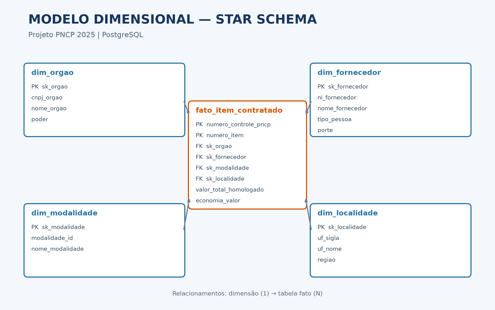
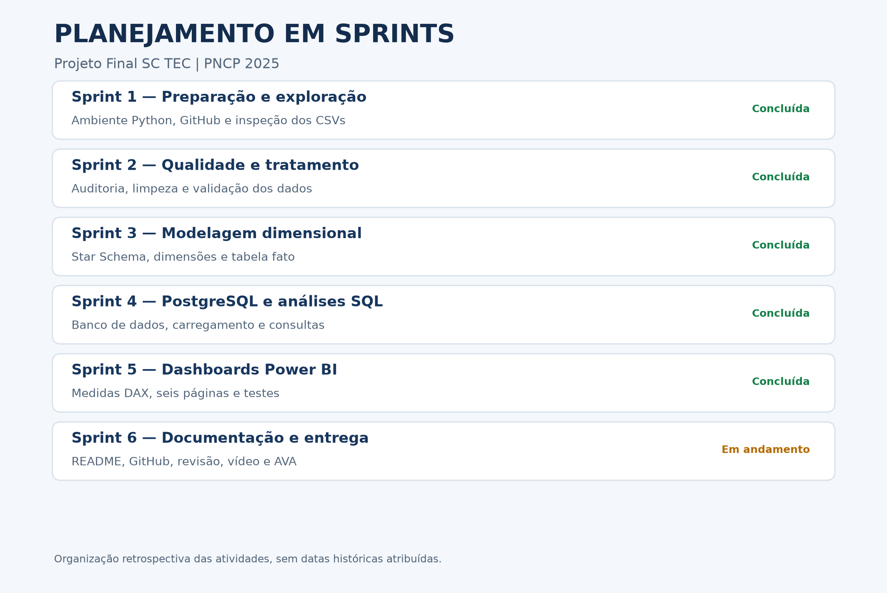

# Projeto Final — Módulo 2 | SC TEC — Análise de Dados

## 1. Apresentação

Este projeto foi desenvolvido como parte da formação em Análise de Dados do programa SC TEC, realizado pelo SENAI/SC.

O objetivo é construir um processo de tratamento, armazenamento e análise de dados de contratações públicas, utilizando informações do Portal Nacional de Contratações Públicas (PNCP), referentes ao ano de 2025.

O projeto integra Python, PostgreSQL e Power BI, permitindo transformar dados brutos em informações úteis para a análise de gastos públicos, fornecedores, modalidades de contratação e indicadores de economia.

## 2. Tecnologias utilizadas

- **Python:** inspeção, limpeza, transformação e preparação dos dados.
- **Pandas:** manipulação e tratamento dos arquivos CSV.
- **PostgreSQL:** armazenamento dos dados tratados em um modelo dimensional (Star Schema).
- **SQL:** consultas, validações e análises dos dados.
- **Power BI:** criação de indicadores e dashboards interativos.
- **Git e GitHub:** versionamento, documentação e publicação do projeto.
- **VS Code:** desenvolvimento e execução dos scripts Python.

## 3. Objetivo da análise

Analisar dados de contratações públicas do PNCP 2025, buscando responder a questões relacionadas a:

- Valores estimados e homologados das contratações.
- Indicadores de economia nas contratações.
- Participação e concentração de fornecedores.
- Distribuição dos gastos por modalidade de contratação.
- Duração dos ciclos de contratação.
- Distribuição regional dos gastos públicos.
- Perfil dos órgãos compradores.


## 4. Estrutura do projeto

O projeto está organizado nas seguintes pastas:

```text
Projeto Final - Módulo 2/
├── data/
│   ├── raw/
│   │   ├── compras.csv
│   │   ├── itens.csv
│   │   └── resultados.csv
│   └── processed/
│       ├── dim_fornecedor.csv
│       ├── dim_localidade.csv
│       ├── dim_modalidade.csv
│       ├── dim_orgao.csv
│       └── fato_item_contratado.csv
├── docs/
│   ├── indicadores_sql.md
│   └── relatorio_qualidade.md
├── powerbi/
│   └── pncp_2025_dashboard.pbix
├── sql/
│   ├── 01_criar_banco.sql
│   ├── 01_criar_esquema.sql
│   ├── 02_analises_exploratorias.sql
│   ├── 02_perguntas.sql
│   └── 03_analises_joins.sql
├── src/
│   ├── __init__.py
│   ├── auditoria_formatos.py
│   ├── banco.py
│   ├── carregar.py
│   ├── config.py
│   ├── inspecao.py
│   ├── limpeza.py
│   ├── montar_tabelas.py
│   └── validar_relacionamentos.py
├── .env.example
├── .gitignore
├── README.md
└── requirements.txt
```

### Descrição das pastas

- `data/raw/`: arquivos CSV originais utilizados como fontes de dados.
- `data/processed/`: arquivos CSV preparados para a carga no banco de dados.
- `docs/`: documentação das análises SQL e da qualidade dos dados.
- `powerbi/`: relatório interativo desenvolvido no Power BI.
- `sql/`: scripts SQL de criação, consulta e análise.
- `src/`: scripts Python utilizados no processamento dos dados.

**Observação:** o arquivo `.env` contém configurações locais e não deve ser publicado no GitHub.


## 5. Processamento e tratamento dos dados (ETL)

O processo de ETL (Extract, Transform, Load) foi desenvolvido utilizando Python e Pandas, com o objetivo de preparar os dados do PNCP 2025 para armazenamento e análise no PostgreSQL.

### 5.1. Extração dos dados

Foram utilizados três arquivos CSV:

- `compras.csv`: informações sobre os processos de contratação.
- `itens.csv`: informações sobre os itens das contratações.
- `resultados.csv`: informações sobre os resultados dos itens e fornecedores.

### 5.2. Inspeção e auditoria

A etapa de inspeção verificou:

- Estrutura e quantidade de registros.
- Tipos de dados e valores ausentes.
- Duplicidades.
- Formatos de datas e valores monetários.
- Integridade dos relacionamentos entre compras, itens e resultados.

A documentação detalhada está disponível em `docs/relatorio_qualidade.md`.

### 5.3. Limpeza e transformação

O processamento contempla:

- Padronização dos formatos de datas.
- Conversão de valores monetários para tipos numéricos.
- Tratamento de valores ausentes conforme as regras de cada campo.
- Verificação das chaves de relacionamento.
- Preparação das tabelas dimensionais e da tabela fato.

Os scripts estão organizados na pasta `src/`.

### 5.4. Modelo dimensional

Os dados foram organizados em um modelo Star Schema (esquema estrela), composto por:

**Tabela fato:**
- `fato_item_contratado`

**Tabelas dimensão:**
- `dim_fornecedor`
- `dim_orgao`
- `dim_modalidade`
- `dim_localidade`

Essa estrutura facilita a criação de consultas analíticas e o relacionamento dos dados com o Power BI.


**Diagrama do modelo dimensional (Star Schema):**



O modelo possui quatro dimensões relacionadas à tabela fato `fato_item_contratado` por chaves estrangeiras, com relacionamentos de um para muitos (1:N).


### 5.5. Armazenamento

Os dados tratados foram carregados no PostgreSQL, permitindo executar consultas SQL e conectar o banco ao Power BI para a construção dos dashboards.


## 6. Análises SQL

As consultas SQL foram utilizadas para validar a integridade dos dados e explorar os resultados das contratações públicas do PNCP 2025.

As análises incluem:

- Verificação da quantidade de registros nas tabelas.
- Validação dos relacionamentos entre fato e dimensões.
- Análise de valores estimados e homologados.
- Identificação dos principais fornecedores e órgãos compradores.
- Distribuição dos gastos por modalidade de contratação.
- Análises de concentração e distribuição dos gastos.

Os scripts SQL estão disponíveis na pasta `sql/`.

A documentação dos indicadores pode ser consultada em `docs/indicadores_sql.md`.

## 7. Dashboards no Power BI

Foi desenvolvido um relatório interativo no Power BI, conectado ao banco PostgreSQL, contendo seis páginas analíticas.

### Dashboard 1 — Economia nas Contratações

Apresenta indicadores de volume homologado, valores estimados comparáveis, economia e evolução mensal das contratações.

### Dashboard 2 — Fornecedores e Concentração

Apresenta os principais fornecedores, sua participação no volume homologado e indicadores de concentração.

### Dashboard 3 — Modalidades de Contratação

Analisa a distribuição dos valores homologados por modalidade, a participação percentual e as diferenças em relação à média geral.

### Dashboard 4 — Ciclo das Contratações

Analisa a duração dos processos de contratação, incluindo ciclo médio, ciclo máximo e evolução mensal.

### Dashboard 5 — Análise Regional

Apresenta a distribuição geográfica dos valores homologados por estado e região do Brasil.

### Dashboard 6 — Perfil de Gastos

Apresenta os principais órgãos compradores e a distribuição dos valores homologados por Poder Público.

### 7.1. Principais indicadores

| Indicador | Resultado |
|---|---:|
| Volume homologado | R$ 8,04 bilhões |
| Valor estimado comparável | R$ 6,87 bilhões |
| Economia apurada | R$ 992,86 milhões |
| Economia percentual | 14,46% |
| Itens comparáveis | 89,08% |
| Fornecedores | 2.652 |
| Unidades compradoras | 363 |
| Ciclo médio | 48,1 dias |
| Ciclo máximo | 611 dias |

Os indicadores foram calculados a partir dos dados tratados e das medidas utilizadas no Power BI.

### 7.2. Arquivo do dashboard

O relatório está disponível em:

`powerbi/pncp_2025_dashboard.pbix`

Para abrir o arquivo, é necessário utilizar o Power BI Desktop. A atualização dos dados depende da disponibilidade do banco PostgreSQL e das configurações de conexão.


## 8. Como preparar o ambiente

### 8.1. Pré-requisitos

Para executar o projeto, é necessário ter instalado:

- Python
- PostgreSQL
- Power BI Desktop
- Git
- Visual Studio Code (recomendado)

### 8.2. Clonar o repositório

No terminal PowerShell:

```powershell
git clone https://github.com/luizcfreitasneto/projeto-final-modulo-2-sc-tec.git
cd projeto-final-modulo-2-sc-tec
```

### 8.3. Criar o ambiente virtual

```powershell
python -m venv .venv
```

### 8.4. Ativar o ambiente virtual

No Windows PowerShell:

```powershell
.\.venv\Scripts\Activate.ps1
```

Caso o PowerShell bloqueie a ativação, execute:

```powershell
Set-ExecutionPolicy -Scope Process -ExecutionPolicy Bypass
```

Depois, tente ativar o ambiente novamente.

### 8.5. Instalar as dependências

Com o ambiente virtual ativado:

```powershell
python -m pip install -r requirements.txt
```

### 8.6. Configurar as variáveis de ambiente

O arquivo `.env.example` serve como referência para configurar a conexão com o PostgreSQL.

Crie um arquivo `.env` na pasta principal do projeto e preencha as variáveis conforme o modelo disponibilizado.

O arquivo `.env` não deve ser enviado ao GitHub, pois pode conter informações sensíveis, como senhas de acesso ao banco de dados.

### 8.7. Inspecionar os dados

Com os arquivos CSV disponíveis em `data/raw/`, execute:

```powershell
python -m src.inspecao
```

Para realizar a auditoria dos formatos:

```powershell
python -m src.auditoria_formatos
```

Para verificar os relacionamentos:

```powershell
python -m src.validar_relacionamentos
```

### 8.8. Preparar e carregar os dados

Os scripts de transformação e carga estão disponíveis na pasta `src/`.

**Atenção:** o módulo `src.carregar` pode recriar o banco de dados configurado, eliminando tabelas e dados existentes.

Antes de executar qualquer rotina de carga, confira o código, as variáveis de ambiente e o banco de destino. Utilize preferencialmente um banco de testes ou um ambiente preparado para essa finalidade.

### 8.9. Abrir o relatório Power BI

Abra o arquivo:

`powerbi/pncp_2025_dashboard.pbix`

No Power BI Desktop, verifique as configurações da fonte PostgreSQL.

A atualização dos dados depende de uma conexão válida com o banco de dados utilizado pelo projeto.


## 9. Planejamento em Sprints

O desenvolvimento do projeto foi organizado retrospectivamente em seis Sprints, abrangendo preparação, qualidade dos dados, modelagem dimensional, PostgreSQL, Power BI e documentação.



O detalhamento das atividades está disponível em [Planejamento das Sprints](docs/planejamento_sprints.md).


## 10. Decisões técnicas

Durante o desenvolvimento do projeto, foram adotadas as seguintes decisões:

- **Python e Pandas:** utilizados para inspeção, auditoria, limpeza e transformação dos dados.
- **PostgreSQL:** escolhido para armazenar os dados tratados e permitir consultas SQL.
- **Modelo Star Schema:** adotado para organizar os dados em uma tabela fato e quatro dimensões, facilitando as análises.
- **Chaves substitutas:** utilizadas nas dimensões para estabelecer relacionamentos com a tabela fato.
- **Validação de integridade:** realizada para identificar valores ausentes, duplicidades e inconsistências nos relacionamentos.
- **Tratamento de datas e valores monetários:** necessário devido à diversidade de formatos encontrados nos arquivos originais.
- **Power BI:** utilizado para apresentar indicadores, gráficos e análises interativas.
- **GitHub:** utilizado para versionamento, documentação e disponibilização dos arquivos do projeto.

## 11. Limitações e melhorias futuras

### Limitações

- A análise utiliza os dados disponibilizados para o projeto, não representando necessariamente todas as contratações públicas de 2025.
- Alguns registros apresentam informações ausentes, o que limita determinadas análises.
- O cálculo de economia considera apenas os itens classificados como comparáveis.
- Os resultados dependem da qualidade e da cobertura dos dados de origem.

### Melhorias futuras

- Automatizar a atualização dos dados por meio de um pipeline agendado.
- Integrar novas bases e períodos do PNCP.
- Implementar testes automatizados de qualidade dos dados.
- Criar mecanismos de monitoramento e registro de falhas do ETL.
- Ampliar os indicadores e análises do Power BI.
- Disponibilizar uma solução de atualização periódica do dashboard.

